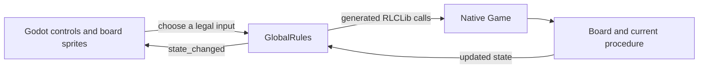
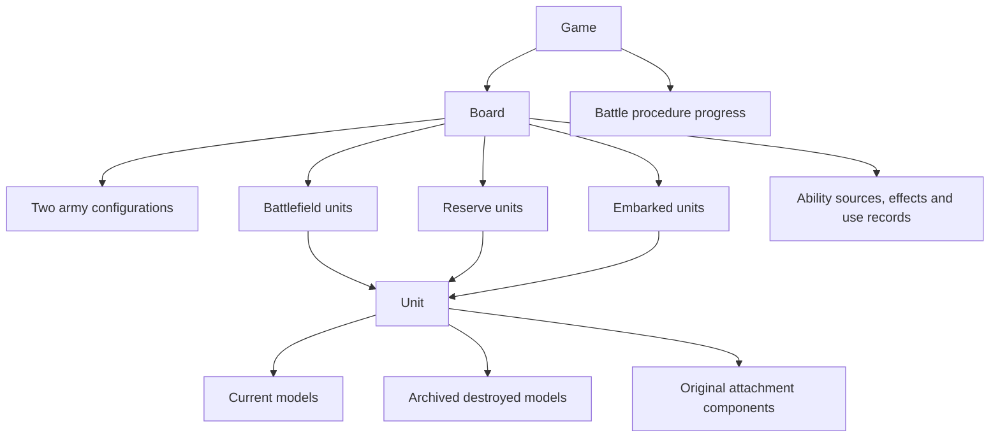

# The game engine: a guide for 40K and Godot users

This guide assumes you know what a unit, a weapon profile, a phase and a Godot
scene are. It explains how 4Hammer represents a battle and how the Godot client
interacts with it. You do not need to know Rulebook to read it.

Use [ROADMAP.md](../ROADMAP.md) for implementation status and validation evidence,
the [procedural core reference](11th-edition-core-rules-procedural.txt) for
page-linked rules, and the [technical architecture guide](rulebook-architecture.md)
when changing the implementation. This document describes the current engine;
it is not a replacement for the rules or a claim that every possible 40K army
and mission is implemented.

## What game can this engine represent?

The current migration implements the supplied 11th-edition core rules within
the project's agreed scope. The current army implementation is **54 standard
Orks datasheets**, with their supported equipment, attachments and abilities,
the 15 ordinary detachments, enhancements/upgrades and CP-based stratagems.
Public roster selection can build these units rather than only a fixed starter.
Other factions still have legacy scenario/Combat Patrol data. Their presence in
a menu, enum or test fixture does not certify their current-edition datasheets.

Several deliberate choices affect what you see:

| Area | Current behavior | Why it matters to a 40K player |
| --- | --- | --- |
| Army construction | At most three detachments; no points or detachment-cost calculation; CP costs are tracked | The roster is not an official points-balanced list validator |
| Mission | Public play explicitly uses a legacy four-marker scoring fixture | Core objective-control support does not supply every published mission |
| Position | Whole-inch positions on a 44-by-30-inch grid | A legal tabletop placement between grid points may be unavailable here |
| Bases and hulls | Circular bases; ovals intentionally use a circle based on their long axis; Use-model hulls have explicitly imprecise circular proxies | Distances, overlap and fitting through gaps reflect the proxy, not a sculpted hull |
| Visibility | Units are treated as at least visible when on the battlefield; intervening terrain areas supply partial obscuring | No model-body ray casting through windows or individual terrain features |
| Coherency | Printed neighbour/distance checks plus one connected group of living models | Disconnected coherent-looking clusters are rejected by an explicit user ruling |
| Source ordering | Current player's simultaneous effects first, in their chosen order, then the opponent's | This is the supplied sequencing ruling used by the engine |
| Excluded data | Forge World and Legends, including Gargantuan Squiggoth | Historical catalog names for excluded units are not playable implementations |

These are different kinds of authority: core rules come from the supplied
rulebook; missing appendix/datasheet definitions were supplied separately;
grid, proxies and the extra connectivity requirement are project/user choices.
Source comments and the roadmap distinguish them. A future faction should use
the existing common mechanics and provide its own actual permissions and data.

## Tabletop words and engine words

| Tabletop concept | Engine representation | Example |
| --- | --- | --- |
| The whole battle, including the decision being resolved | `Game` | Waiting for a save roll is part of the saved game |
| Battlefield and all information needed to run it | `Board` | Contains reserves and passengers as well as deployed units |
| A player's army configuration | `ArmyConfiguration` | Chosen faction, detachments and persistent Warlord identity |
| A unit participating in the battle | `Unit` | Bodyguards and attached Leader/Support models can be one combined unit |
| A particular miniature | `Model` | Has its own wounds suffered, equipment, keywords and identity |
| Printed characteristics | `Profile` and `Weapon` | A model profile supplies T and W; a weapon profile supplies S, AP and D |
| One physical weapon with alternative firing modes | Model equipment slot/group plus profile identities | Selecting supercharge does not create a second physical plasma gun |
| A declared use of a weapon | `DeclaredWeapon` | Remembers the bearer, selected profile and declared target shares |
| The attacks currently being resolved | `AttackSequenceInfo` | Gathered strength, modifiers, rules and target toughness |
| An ability that can trigger | `SourceInstance` | A registered source with conditions and use limits |
| An ability's continuing result | `SourceEffect` plus recipient grants | A repair buff lasts until its specified boundary |
| A choice awaiting input | An action frame | Movement waits for a position; allocation waits for a model |

`Profile` and `Weapon` are named value catalogs, not per-miniature Godot
resources. Two models can use the same printed profile while retaining
different wounds, weapons, effects and identities. Effective characteristics
come from queries which combine that printed data with applicable modifiers.

## How the Godot scene relates to the rules

The simulation is native Rulebook code exposed by the generated Godot extension.
`GlobalRules`, implemented in [Rules.gd](../scripts/Rules.gd), owns the native
`RLCGame` and an `RLCLib` object used to call its functions. A model sprite is
a view of a native `Model`; moving that sprite does not move the game model.
Likewise, `RLCUnit` is a generated wrapper around a native value, not a scene
node that owns its own independent turn or physics.

The engine exposes possible inputs as generated action values. Godot checks
which are legal at the current decision and displays controls for them. A
selected input advances the rules until the next decision or completion. Dice
are also explicit inputs, so the same initial state and input sequence can be
replayed without hidden random calls inside the rules.

An input describes a choice, not necessarily a whole tabletop operation. Moving
a formation may finish in one position input; moving models individually takes
several inputs. Shooting can stop for weapon selection, target selection, dice,
allocation, saves and reactions. Those stops are stored in the `Game`, alongside
the board, so saving halfway through an attack is meaningful.

## Who owns what?

The three collections of units are storage locations, also called **banks**.
An embarked unit belongs in `embarked_units`, linked to the carrier model's
identity. It is not represented by a second miniature on the battlefield.
Reserve/embarked units cannot borrow their old positions to measure external
visibility or range. Their permitted own-unit abilities can still operate, and
their histories and persisting effects remain real game state.

An attached unit retains the bodyguard unit's identity and remembers the
original Leader/Support components. Keywords on the combined unit are queried
across its members; that does not copy a Leader's keywords to every individual
model. Destroying the bodyguards does not manufacture a new Leader unit or
erase the original component's ability-use history.

## A slot is not an identity

`UnitID` and `ModelID` select an entry in a particular collection. They are
small indices, and **zero is a valid first entry**. Their meaning comes from the
current action and its bank: reserve unit 0 need not be battlefield unit 0.

`EntityIdentity` identifies the actual unit or model over time. Zero means
unassigned; assigned identities are positive. Use identity when following a
particular miniature through attachment, casualty removal, embarking or return.
Carrier links, Warlord selection and original-unit provenance use identities.

For example, if models A, B and C occupy indices 0, 1 and 2, removing B compacts
the vector: C now occupies index 1. A stored `ModelID(1)` would select C, while
B's identity still identifies B in the destroyed-model archive. Returning B
restores the original model and equipment history; it need not restore index 1.
Battlefield unit slots instead retire rather than immediately compacting.

Re-fetch native references after an input that can replace a board, move a unit
between banks or resize a vector. A wrapper obtained before that operation is
not a promise of a stable object address. Stable game identity and a live Godot
wrapper are separate concepts.

## Where to read next

- [Game state reference](game-state-reference.md): exact field names, types,
  sentinels, meanings and lifetimes for the important engine structs.
- [Technical architecture](rulebook-architecture.md): module boundaries, action
  frames, ownership and extension points for implementation work.
- [Public Orks roster](orks-custom-roster.md): supported army construction and
  shared rules across banks.
- [Rules reference](11th-edition-core-rules-procedural.txt) and
  [supplied appendix](11th-edition-supplied-appendix.md): rule authority.
- [Roadmap](../ROADMAP.md) and [validation instructions](../tests/README.md):
  what has actually been checked and how to reproduce relevant checks.
