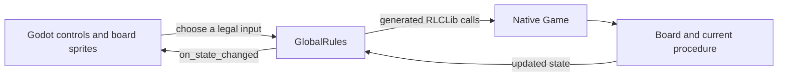
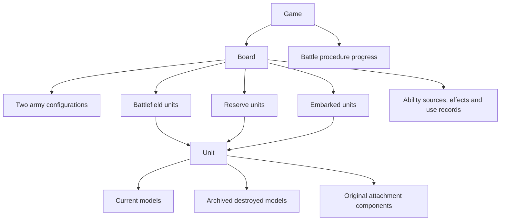
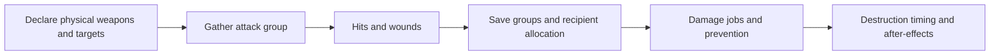

# The game engine: a guide for 40K and Godot users

This guide assumes you know what a unit, a weapon profile, a phase and a Godot
scene are. It explains how 4Hammer represents a battle and how the Godot client
interacts with it. You do not need to know Rulebook to read it.

Use [ROADMAP.md](../ROADMAP.md) for implementation status and validation evidence,
the [procedural core reference](11th-edition-core-rules-procedural.txt) for
page-linked rules, and the [technical architecture guide](rulebook-architecture.md)
when changing the implementation. This document describes the current engine;
it is not a replacement for the rules or a claim that every possible 40K army
and mission is implemented.

## Reading path

- [Implemented scope](#what-game-can-this-engine-represent)
- [Tabletop vocabulary](#tabletop-words-and-engine-words)
- [Godot and the native rules](#how-the-godot-scene-relates-to-the-rules)
- [Ownership](#who-owns-what) and [indices versus identities](#a-slot-is-not-an-identity)
- [Turn and decision ownership](#whose-turn-is-it-and-whose-choice-is-it)
- Worked flows: [shooting](#worked-flow-a-shooting-attack),
  [casualties/returns](#worked-flow-a-leader-dies-or-a-model-returns),
  [lasting effects](#worked-flow-a-repair-buff-expires)
- [Godot example](#godot-example-read-state-inspect-a-choice-and-apply-it)
- [Property reference](game-state-reference.md)

## What game can this engine represent?

The current migration implements the supplied 11th-edition core rules within
the project's agreed scope. The current army implementation is **54 standard
Orks datasheets**, with their supported equipment, attachments and abilities,
the 15 ordinary detachments, enhancements/upgrades and CP-based stratagems.
Public roster selection can build these units rather than only a fixed starter.
Other factions still have legacy scenario/Combat Patrol data. Their presence in
a menu, enum or test fixture does not certify their current-edition datasheets.
The non-rendering Godot bindings/controls have validation coverage; complete
rendered integration of the new roster is outside the current migration scope.

Several deliberate choices affect what you see:

| Area | Current behavior | Why it matters to a 40K player |
| --- | --- | --- |
| Army construction | At most three detachments; no points or detachment-cost calculation; CP costs are tracked | The roster is not an official points-balanced list validator |
| Mission | Public play explicitly uses a legacy four-marker scoring fixture | Core objective-control support does not supply every published mission |
| Position | Whole-inch positions on a 44-by-30-inch grid | A legal tabletop placement between grid points may be unavailable here |
| Bases and hulls | Circular bases; ovals intentionally use a circle based on their long axis; Use-model hulls have explicitly imprecise circular proxies | Distances, overlap and fitting through gaps reflect the proxy, not a sculpted hull |
| Visibility | Physical body occlusion is assumed away; terrain areas supply partial obscuring; Hidden, Lone Operative and offboard restrictions still apply | No model-body ray casting through windows or individual terrain features |
| Coherency | Printed neighbour/distance checks plus one connected group of living models | Disconnected coherent-looking clusters are rejected by an explicit user ruling |
| Source ordering | Current player's simultaneous effects first, in their chosen order, then the opponent's | This is the supplied sequencing ruling used by the engine |
| Excluded data | Forge World and Legends, including Gargantuan Squiggoth | Historical catalog names for excluded units are not playable implementations |

These are different kinds of authority: core rules come from the supplied
rulebook; missing appendix/datasheet definitions were supplied separately;
grid, proxies and the extra connectivity requirement are project/user choices.
Source comments and the roadmap distinguish them. A future faction should use
the existing common mechanics and provide its own actual permissions and data.

## Tabletop words and engine words

| Tabletop concept | Engine representation | Example |
| --- | --- | --- |
| The whole battle, including the decision being resolved | `Game` | Waiting for a save roll is part of the saved game |
| Battlefield and all information needed to run it | `Board` | Contains reserves and passengers as well as deployed units |
| A player's army configuration | `ArmyConfiguration` | Chosen faction, detachments and persistent Warlord identity |
| A unit participating in the battle | `Unit` | Bodyguards and attached Leader/Support models can be one combined unit |
| A particular miniature | `Model` | Has its own wounds suffered, equipment, keywords and identity |
| Printed characteristics | `Profile` and `Weapon` | A model profile supplies T and W; a weapon profile supplies S, AP and D |
| One physical weapon with alternative firing modes | Model equipment slot/group plus profile identities | Selecting supercharge does not create a second physical plasma gun |
| A declared use of a weapon | `DeclaredWeapon` | Remembers the bearer, selected profile and declared target shares |
| The attacks currently being resolved | `AttackSequenceInfo` | Gathered strength, modifiers, rules and target toughness |
| An ability that can trigger | `SourceInstance` | A registered source with conditions and use limits |
| An ability's continuing result | `SourceEffect` plus recipient grants | A repair buff lasts until its specified boundary |
| A choice awaiting input | An action frame | Movement waits for a position; allocation waits for a model |

`Profile` and `Weapon` are named value catalogs, not per-miniature Godot
resources. Two models can use the same printed profile while retaining
different wounds, weapons, effects and identities. Effective characteristics
come from queries which combine that printed data with applicable modifiers.

## How the Godot scene relates to the rules



The simulation is native Rulebook code exposed by the generated Godot extension.
`GlobalRules`, implemented in [Rules.gd](../scripts/Rules.gd), owns the native
`RLCGame` and an `RLCLib` object used to call its functions. A model sprite is
a view of a native `Model`; moving that sprite does not move the game model.
Likewise, `RLCUnit` is a generated wrapper around a native value, not a scene
node that owns its own independent turn or physics.

The engine exposes possible inputs as generated action values. Godot checks
which are legal at the current decision and displays controls for them. A
selected input advances the rules until the next decision or completion. Dice
are also explicit inputs, so the same initial state and input sequence can be
replayed without hidden random calls inside the rules.

An input describes a choice, not necessarily a whole tabletop operation. Moving
a formation may finish in one position input; moving models individually takes
several inputs. Shooting can stop for weapon selection, target selection, dice,
allocation, saves and reactions. Those stops are stored in the `Game`, alongside
the board, so saving halfway through an attack is meaningful.

## Who owns what?



The diagram shows ownership types: an active unit occupies one real bank at a
time, while a retired battlefield slot can retain bookkeeping for its return.
The three collections of units are storage locations, also called **banks**.
An embarked unit belongs in `embarked_units`, linked to the carrier model's
identity. It is not represented by a second miniature on the battlefield.
Reserve/embarked units cannot borrow their old positions to measure external
visibility or range. Their permitted own-unit abilities can still operate, and
their histories and persisting effects remain real game state.

An attached unit retains the bodyguard unit's identity and remembers the
original Leader/Support components. Keywords on the combined unit are queried
across its members; that does not copy a Leader's keywords to every individual
model. Destroying the bodyguards does not manufacture a new Leader unit or
erase the original component's ability-use history.

## A slot is not an identity

`UnitID` and `ModelID` select an entry in a particular collection. They are
small indices, and **zero is a valid first entry**. Their meaning comes from the
current action and its bank: reserve unit 0 need not be battlefield unit 0.

`EntityIdentity` identifies the actual unit or model over time. Zero means
unassigned; assigned identities are positive. Use identity when following a
particular miniature through attachment, casualty removal, embarking or return.
Carrier links, Warlord selection and original-unit provenance use identities.

For example, if models A, B and C occupy indices 0, 1 and 2, removing B compacts
the vector: C now occupies index 1. A stored `ModelID(1)` would select C, while
B's identity still identifies B in the destroyed-model archive. Returning B
restores the original model and equipment history; it need not restore index 1.
Battlefield unit slots instead retire rather than immediately compacting.

Re-fetch native references after an input that can replace a board, move a unit
between banks or resize a vector. A wrapper obtained before that operation is
not a promise of a stable object address. Stable game identity and a live Godot
wrapper are separate concepts.

Numbers also carry meaning beyond their primitive type. A movement limit can
encode inches+1 so zero means 'no override', while a normal position of zero is
a real coordinate. Read the [bounds/sentinel conventions](game-state-reference.md#numbers-units-and-sentinels)
before interpreting an unfamiliar numeric property.

## Whose turn is it, and whose choice is it?

These questions have different answers during an attack or reaction:

| Value | Meaning | Example during player 0's Shooting phase |
| --- | --- | --- |
| `board.current_player` | Turn owner | Remains player 0 while player 1 allocates damage |
| `board.timing.active_player` | Active role in the nested operation | A reaction can temporarily use player 1's role and restore the caller afterward |
| `board.current_decision_maker` | Owner of an ordinary pending decision | Player 1 can choose a defending model |
| `library.get_current_player(game)` | Public decision classification | 0/1 for player input, -1 for chance, -4 when the game is done |

The Boolean player fields use false/true for engine player indices 0/1. Do not
read the legacy name `owned_by_player1` as a reliable human-facing 'Player 1'
label. Use the application's player-index mapping consistently.

The public classification recognizes dice-shaped inputs before consulting the
ordinary decision-owner Bool. Consequently the Bool can still contain a player
while `get_current_player` correctly reports chance. Completion is similarly
queried through the frame, not through a current phase label alone.

An ability's **trigger**, **use**, and **effect** also differ. A `SourceInstance`
defines a real ability and its eligibility. A `PendingSourceEvent` is a collected
candidate to resolve. Accepting it commits a `SourceUseRecord` where required;
it can then install a lasting `SourceEffect`. Two abilities with similar text
do not automatically share a use limit: their explicit rule/scope keys decide.

## Worked flow: a shooting attack

Suppose a unit fires a selected plasma profile into an enemy unit. This example
explains the engine stages; the actual equipped profile and source rules still
determine what is permitted.

1. **Select the attacker and mode.** Eligibility checks timing, setup, movement,
   engagement and source permissions. Selection effects resolve before weapons
   and targets are committed.
2. **Declare equipped weapons, profiles and targets.** A `DeclaredWeapon`
   remembers the physical bearer, selected profile, target choices and required
   declaration snapshots. Standard/supercharge profiles of one physical copy
   are normally alternatives, not two independent guns. One Shot and Hazardous
   bookkeeping follow the physical copy.
3. **Recheck targets and choose the group to resolve.** A target that became
   ineligible uses the defined retarget/discard path. Resolve one target fully
   before switching. Gather compatible attacks; determine random A separately
   for each selected weapon. Grouping does not discard source/provenance facts.
4. **Gather the active attack context.** `AttackSequenceInfo` combines the
   selected profile/rules with the effective bearer and target facts needed for
   this group. It distinguishes WS/BS operations from hit-roll operations.
5. **Resolve hit and wound dice.** Original dice are explicit inputs; rerolls
   precede modifiers. An original die cannot be rerolled twice. Natural and
   critical-result rules are distinct from modified totals. Supported optional
   modifier choices retain each operation's provenance.
6. **Resolve defender save groups and allocation.** `AllocationGroup` records
   compatible live recipients by identity. The defender orders legal groups;
   characters and wounded priorities are respected, with Precision's explicit
   override where eligible. Save results are collected before the corresponding
   reroll/damage processing. A save is not a second independent InSv roll.
7. **Apply each failed save's attack.** Choose the actual eligible recipient,
   determine random D at the required point, combine outgoing and incoming
   modifiers, apply prevention and commit wound loss through the common damage
   runner. Ordinary damage does not freely spill across models.
8. **Finish the activation's aftermath.** Remaining groups/targets, deferred
   destruction, selected physical Hazardous weapons and source-specific
   after-effects follow their prescribed order. A nested reaction restores its
   caller's roles/selection context when it finishes.



Several of these stages can be waiting for input at once in the call chain;
only the currently exposed inputs are legal. `Board.attack_info` describes the
current group, while the declaration collection remembers the wider commitment.
Neither is a complete historical battle log.

## Worked flow: a Leader dies, or a model returns

Consider a bodyguard unit with an attached Leader. The combined `Unit` retains
the bodyguard identity and an `AttachmentComponent` for the Leader's original
unit. Each model retains its own identity and original component.

If the Leader is destroyed during an enemy activation, these are separate facts:
the model has no remaining wounds; its destruction can be pending; it may still
be physically retained for a source-defined timing; and applicable conferred
unit rules may survive until the attacking unit's attacks end. The retained
model is not thereby a normal living recipient or an arbitrary active ability
source. Conversely, losing all the bodyguards does not split/recreate the
combined unit or reset its original component histories.

When removal is allowed, the original model is archived and the live model
vector can compact. This is why a model index is unsuitable for a delayed
'return that model' instruction. A source which returns it must preserve the
original identity, equipment, physical weapon use and component provenance.

Ordinary `heal_unit` first heals wounded living models. If its remaining wound
allowance can return a casualty, it offers eligible original non-Characters and
uses phase-start placement constraints. It does not infer Character resurrection
from the presence of a dead Leader. An explicit rule such as Surly supplies its
own trigger, expenditure, roll, wound count and nearest-unengaged policy, then
calls the shared `return_model` procedure directly.

A successful return clears death-only state and restores the original model;
an explicit return can reactivate the retired unit slot. A battlefield return
needs a supported legal grid position. A reserve return needs no battlefield
coordinate; an embarked return still needs actual carrier permission and room.
The same model-return mechanism handles those banks without constructing an
imaginary battlefield copy.

## Worked flow: a repair buff expires

A Mek repair can install a source-owned hit contribution on its actual vehicle
recipient. The `SourceInstance` records the rule/bearer and permission; a use
record tracks the printed limit; the `SourceEffect` identifies the recipients
and expiry; the model's modifier/grant records carry that effect key.

When a rule lasts until the next own Movement phase, it does not expire at the
start of next turn or Command phase. Source refresh tests the named boundary
and owner. If two independent legal effects grant matching bonuses, removing
one key must not remove the other. If a source requires a live conferring bearer,
that condition is checked separately from elapsed duration.

Embarking or entering reserves does not automatically cancel a persisting
effect. Offboard units keep their actual records, and effect expiry/reset scans
operate across all banks. That does not let a passenger measure an aura to an
unrelated battlefield unit from its stale position.

## Examples backed by regressions

These names in [baseline.rl](../tests/baseline.rl) are useful entry points when
you want to check a particular explanation rather than replay a full game:

| Topic | Existing assertion |
| --- | --- |
| Effective range and declaration snapshots | `test_orks17c2b_half_range_snapshot_uses_effective_range` |
| Effective characteristics separate attack groups | `test_orks17c2b_group_identity_splits_effective_strength` |
| Precision allocation | `test_damage_precision_character_group_and_fallback` |
| Attached unit versus model keywords | `test_attachment17g_keyword_union_not_model_spread` |
| Bodyguard destruction preserves the unit | `test_attachment17g_bodyguard_death_keeps_combined_unit` |
| Generic healing allowance | `test_procedures_heal_full_allowance_without_faction` |
| Original model identity on return | `test_procedures_return_original_model_nearest_without_faction` |
| Same return behavior in all banks | `test_orks17q_shared_surly_all_banks` |

The [reference](game-state-reference.md) gives the fields behind these flows.
The [test instructions](../tests/README.md) explain how to select an individual
native assertion. Read a fixture as evidence for its specific case, not as a
datasheet permission for a different army.

## Godot example: read state, inspect a choice and apply it

This is a complete headless `SceneTree` script for a project configured with
the current native extension and `GlobalRules` autoload, like the existing
[Godot checks](../tests/godot_shared_procedures.gd). The first part creates an
**isolated data-preview fixture** so it can demonstrate a model read before a
real game has finished choosing armies. Those direct fixture assignments are
not the route for playing or changing an ongoing battle.

The second part uses the actual autoload's legal choices. It applies exactly
one currently legal input through `GlobalRules.apply_action`, which refreshes
the legal list and emits its ordinary notifications. It does not assume that
the next input is a move, an attack or a complete turn.

```gdscript
extends SceneTree

var change_notifications = 0

func _initialize():
    call_deferred("demo")

func on_changed():
    change_notifications += 1

func print_unit(library, bank, index):
    assert(index >= 0 and index < library.size(bank))
    var unit = library.get(bank, index)
    print("Unit identity: ", unit.get_identity().get_value())
    for member in range(library.size(unit.get_models())):
        var model = library.get(unit.get_models(), member)
        print("Model ", model.get_identity().get_value(),
              ": W remaining = ", library.wounds_left(model),
              ", effective Sv = ", library.effective_save(model))

func demo():
    var rules = root.get_node("GlobalRules")
    var library = rules.library
    assert(library.get_state_schema_version() == 40)
    assert(library.get_observation_schema_version() == 40)
    assert(library.get_action_schema_version() == 26)

    # Isolated preview data; this does not modify rules.state.
    var preview = RLCBoard.make()
    library.append(preview.get_units(), library.make_orks_warboss())
    library.identify_units(preview)
    var unit = library.get(preview.get_units(), 0)
    var model = library.get(unit.get_models(), 0)
    model.get_position().get_x().set_value(5)
    model.get_position().get_y().set_value(5)
    assert(model.get_identity().get_value() > 0)
    assert(library.wounds_left(model) == library.wounds(model.get_profile()))
    print_unit(library, preview.get_units(), 0)

    # Inspect the real pending decision using the existing legal-action list.
    assert(not library.is_done(rules.state))
    print("Decision owner: ", library.get_current_player(rules.state))
    assert(not rules.valid_actions.is_empty())
    var choice = rules.valid_actions[0]
    var payload = choice.unwrap()
    print("Input type: ", payload.get_class())
    for member in range(payload.members_count()):
        print("Argument ", member, ": ", payload.get_member(member))

    rules.on_state_changed.connect(on_changed)
    assert(rules.can_apply(choice))
    rules.apply_action(choice)
    assert(change_notifications == 1)
    # Re-fetch Board/Unit/Model wrappers after an input that may change storage.
    var current_board = rules.state.get_board()
    print("Battlefield units now: ", library.size(current_board.get_units()))

    print("PASS: Godot schema exports and engine-guide examples")
    library.free() # Tear down this headless demo; keep it alive in a running app.
    quit(0)
```

For a real reserve-unit inspection, pass
`rules.state.get_board().get_reserve_units()` to `print_unit`; for passengers,
pass `get_embarked_units()`. Check that an index exists before reading it. The
bank is supplied explicitly, so 'unit 0' cannot silently select an unrelated
battlefield unit when you meant a passenger.

An ability/property read is not a full legality check. For example,
`library.is_alive(model)` does not prove that its unit can shoot. The current
action's `can_*`/`can_apply` check includes the relevant state-machine position
and eligibility. Direct child procedures in a test need their declared contexts
again on each input; normal UI play advances the root Game through its payloads.

### How payloads become controls

The `RLCAnyGameAction` wrapper carries one concrete payload, returned by
`unwrap()`. Inspect its member count **before** reading a member. The current
client recognizes these shapes:

| Payload members | Usual interaction | Context that must remain correct |
| --- | --- | --- |
| None | Choice button | Current decision still permits the input |
| One Bool or enum | Choice buttons | Explicit value and rule-specific label |
| One UnitID | Unit selection | Reserve/passenger choices need the actual bank and dedicated buttons |
| Two UnitIDs | Source then target | Source is member 0, target is member 1 |
| One ModelID | Model selection | Current target/mover or explicit offboard unit; not any arbitrary sprite |
| One BoardPosition | Grid position | Whole-inch x/y, converted by the existing interaction layer |
| Other bounded selectors | Rule-specific choice control | Source/allocation/profile context supplied by the relevant handler |

The source code for this bridge is [MultipleChoises.gd](../scripts/MultipleChoises.gd),
[InteractionManager.gd](../scripts/InteractionManager.gd) and
[SelectPointManager.gd](../scripts/SelectPointManager.gd). The source filename
`MultipleChoises` retains its historical spelling. A globally enumerated payload
can still be illegal now; do not offer every payload merely because it exists.

### Native wrappers and saves

Keep `RLCLib` and the owning Game alive while using their generated wrappers.
A getter/library `get` can expose a reference into native storage. To retain a
value independently, construct the appropriate wrapper and use the generated
assignment/clone mechanism deliberately; do not assume ordinary GDScript
variable assignment copies the native value. After vector replacement, state
assignment or bank transfer, obtain fresh references and resolve identities.

Saves contain both Board and procedure progress. Use the root `set_state`
validation path when restoring; it parses into a candidate and rejects invalid
state before committing. Action payload traces, full saves and fuzzer files of
legal-choice ranks are different formats. A replay from another action catalog
is not made compatible just by having the same filename or army names.

Build the native library and generated Godot header/extension from matching
sources. The current compatibility markers are state/observation 40 and action
26, with next-state bound 41. These are storage/API markers, not 'edition 40'.
The last cleanup removed unused exports while retaining the public Game layout;
an old extension still needs rebuilding if it refers to removed native exports.
Use [ROADMAP.md](../ROADMAP.md) and source version helpers for later revisions.

## Where to read next

- [Game state reference](game-state-reference.md): exact field names, types,
  sentinels, meanings and lifetimes for the important engine structs.
- [Technical architecture](rulebook-architecture.md): module boundaries, action
  frames, ownership and extension points for implementation work.
- [Public Orks roster](orks-custom-roster.md): supported army construction and
  shared rules across banks.
- [Rules reference](11th-edition-core-rules-procedural.txt) and
  [supplied appendix](11th-edition-supplied-appendix.md): rule authority.
- [Roadmap](../ROADMAP.md) and [validation instructions](../tests/README.md):
  what has actually been checked and how to reproduce relevant checks.
