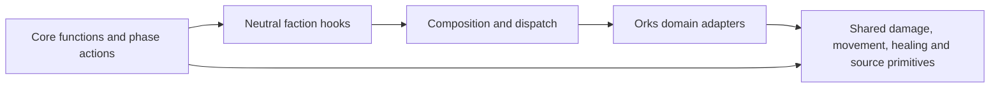

# Separating faction behavior from core rules

This is a proposed refactor, inspected on 2026-10-16 while validating the single
weapon catalog. No dispatch refactor is implemented here. The user's scope is
functions and actions: shared enums may contain Orks weapons, keywords,
datasheets and other values. Splitting catalogs or redesigning all faction
storage is unnecessary for this goal.

## The boundary

Core rules should describe the common game procedure: declare attacks, roll,
allocate, move, resolve simultaneous effects, spend CP and process destruction.
They should ask neutral questions or delegate an appropriate faction window.
An Orks adapter should decide whether Waaagh!, Grot Shields, Pulse Jet or an
Orks support card changes that procedure. Core code should never inspect an
Orks rule number or implement the steps of an Orks ability.

Use ordinary typed functions/actions and finite dispatch. The compiler already
compiles the game together; this needs neither dynamic registration by name nor
a universal interpreter. Shared enums and existing typed faction state can stay
where they are initially. Decoupling behavior does not require claiming the
core is already an independently compiled library.

## Where the coupling actually is

These are representative runtime dependencies, excluding mere catalog rows and
labels. Paths refer to the current implementation.

| Core location | Present behavioral dependency | Proposed neutral responsibility |
| --- | --- | --- |
| [rules.rl](../src/rules.rl), `resolve_timing_window` | Orks timing choices, package windows and rule-code ranges 140–145; Command healing and Scavengers branches | Core owns the two controller groups and interleaving. Faction adapters supply eligible choices and resolve the selected source. |
| `resolve_movement_sources` in the same file | Race, Keep Huntin', Bomb Squig, Mek repair and Shokk-boosta bodies selected by Orks codes | Core owns event collection, ordering and restoration. Delegate the entire accepted faction event. |
| Attack, hit, movement, charge and destruction actions in `rules.rl` | Grot Shield input, hit ledger, selection/reaction actions, Flyin' Headbutt and Orks move effects | Named hooks at actual resolution boundaries; faction actions own faction choices and eligibility. |
| [attack_declarations.rl](../src/attack_declarations.rl), [weapon_abilities.rl](../src/weapon_abilities.rl), [firing_deck_rules.rl](../src/firing_deck_rules.rl) | Direct Orks modifier/rule appenders and reaction-target restriction | Neutral append/permission queries that preserve selected profile, bearer, target, source keys and contribution order. |
| [units.rl](../src/units.rl), [fight_rules.rl](../src/fight_rules.rl), [attack_dice.rl](../src/attack_dice.rl) | Direct enhancement/effect checks for movement, T, InSv, abilities, Fights First and failed hits | Neutral effective-property contributions or already-supported generic grants, keeping core caps/roll order. |
| [movement_rules.rl](../src/movement_rules.rl), [charge_rules.rl](../src/charge_rules.rl), [shooting_rules.rl](../src/shooting_rules.rl), [terrain_rules.rl](../src/terrain_rules.rl) | Specific package/effect checks, Pulse Jet grants, ingress restrictions, Lone Operative and obscuring exceptions | Neutral permissions, contributions and lifecycle callbacks; faction-specific move consequences stay in the adapter. |
| [damage_rules.rl](../src/damage_rules.rl), [source_effects.rl](../src/source_effects.rl) | Orks casualty/hit bookkeeping, event policy, typed-effect installation/removal | Neutral lifecycle callbacks and faction-grant handlers; allocation, FNP, destruction order, expiry and use ledgers stay shared. |
| [transport_rules.rl](../src/transport_rules.rl), [attachment_rules.rl](../src/attachment_rules.rl) | Gretchin seats, cargo passives, Orks passenger/enhancement restrictions | Neutral passenger cost/permission, composition permission and cargo-change hooks. |
| [board.rl](../src/board.rl), [core_stratagem_rules.rl](../src/core_stratagem_rules.rl) | Orks package/CP eligibility, overwatch/action prohibitions, Bunka control and validators | Neutral stratagem eligibility/cost, action permissions, control contribution and validation hooks. |
| Setup and roster actions in `rules.rl` | Concrete Orks roster/option/formation/redeploy actions | Faction-selection dispatcher delegates setup; core owns the common prebattle order. |

The finite source-label lookup and static weapon names are presentation/data,
so they need no behavioral routing. Two small catalog helpers do contain policy:
`simultaneous_weapon_profile` names Nazdreg profiles and `nonattacking_equipment`
names equipment tokens. Their eventual implementation can read generic catalog
properties; Orks entries in those properties remain entirely acceptable.

Some faction-looking helpers are already generic. Move and rename these rather
than adding a dispatch hop:

- `reusable_orks_source_slot`: shared bounded source-pool reuse with generation
  protection and active-effect checks.
- `orks_source_transport_dependency`: shared required-passenger/carrier lifetime
  check; its fields already express the relationship.
- `orks_retained_source_present`: shared retained Fight on Death source presence.

Similarly, generic keyword-predicate builders currently named
`orks_monster_vehicle_rule`/`orks_non_monster_vehicle_rule` can use neutral names.
Actual Orks source availability and effect policy remain faction-specific.

## Functions: concrete contracts

Introduce neutral hooks grouped by responsibility, rather than a single huge
file: combat, movement, lifecycle/sources, setup and permissions. A composition
module under `factions/` is the one place that connects them to the existing
Orks domain modules. Keep those domain adapters; another army should not need
to copy core algorithms.

Reuse `RuleModifiers`, `WeaponAbilitySet`, `SourceEvent`, source/effect keys,
stable entity identities and the existing three source banks. For example, a
neutral weapon-rule hook can append into the same result currently used by the
Orks appenders. A neutral destruction notification can update faction state
after core has determined actual wounds lost and casualty timing. A faction
availability query must remain pure: inspecting a legal action cannot spend CP,
consume a use or register another effect.

Prefer an existing generic grant when it expresses the rule exactly. If a
faction effect grants Assault, a characteristic change or an ordinary permission,
install that generic fact and let core consume it. Keep specialized algorithms
in the faction adapter; do not hide a large Orks switch inside a supposedly
generic interpreter. Rename existing modifier containers/origins only where
their semantics already support all factions. Do not collapse separate modifier
contributions or lose ignore-permission provenance merely to remove a name.

Routing must follow the source of the rule. A source-triggered effect dispatches
using its originating army/faction, not the target's owner. Defensive and
offensive hooks may involve different armies; mixed units and borrowed Firing
Deck weapons require the actual bearer/source context. Unit/model property
queries without a Board need a neutral model/unit hook or generic installed
facts; they cannot be routed solely through `Board.armies`.

If local rule numbers become shared between factions, qualify their ledger
identity by faction before enabling another adapter. Existing per-army/per-owner
usage keys must not merge unrelated abilities with equal local numbers. This
requires a bounded typed identity, not generated strings. Existing Orks-only
numbers may remain during the first extraction.

## Actions: move the whole faction choice

A wrapper around each function call is insufficient. For example, core currently
recognizes a Bomb Squig rule number, offers its target, rolls and invokes mortal
damage. The Orks action should own that entire ability; it can call the existing
shared mortal-damage procedure. The core event resolver should only delegate
the selected source, then restore the controller and pending-event context.

Preserve simultaneous ordering: the current player chooses all of their effects
in any order, then the opponent. Mandatory effects prevent finishing. A neutral
selection action must expose every eligible core/faction alternative at the same
window; running a complete faction batch before the core choices would change
the game. A single choice-delegation routine can offer core and faction child
actions using the language's `subaction` alternatives where their continuations
fit. Use `subaction*` only when the whole chosen child should run to completion;
do not accidentally serialize alternatives or run both branches.

Move existing leaf input declarations with their faction bodies where possible.
Keep UnitID/ModelID/Bool/enum/position payload contracts and Godot bank context.
Do not introduce an extra player-visible “choose faction” step during an
ability. Renaming a private procedure is distinct from renaming a discovered
input action. Compare the public action layout and real Godot choices after
each structural batch; bump schemas whenever the actual saved state changes.

One active shared procedure still gets one context slot. Check call-graph
re-entry before moving a faction wrapper around damage, granted moves or model
return: a dispatcher must not create Damage→Faction→Damage nesting on the same
frame. Keep completed results alive until copied. Generate the action dependency
graph with `rlc ... -dot -o -` and repeat the existing frame-storage audit.

## Focused implementation sequence

1. **Extract genuinely generic helpers.** Move the three source-lifetime/pool
   helpers above to core, rename predicate builders and preserve all callers.
   This removes the existing reverse dependencies without inventing hooks.
2. **Route pure mechanics queries.** Add the neutral dispatch boundary for
   modifiers, weapon rules, effective properties, permissions and transport
   seats. Move embedded enhancement/effect branches into Orks adapters. Keep
   the core arithmetic, caps and source provenance unchanged.
3. **Route lifecycle and sources.** Delegate faction registration, availability,
   typed-grant handling, hit/damage/destruction notifications and validation.
   Generic bank/lifetime/usage machinery remains core. Cover reserves and
   passengers through the same calls as battlefield units.
4. **Move faction action bodies.** Extract timing/movement source branches,
   attack reactions, shock, charge and movement selections into domain adapters,
   called through neutral actions. Keep controller ordering and mandatory-choice
   gates generic. Split this step by window/domain for reviewable commits.
5. **Route prebattle construction.** Dispatch roster/options/Warlord/formation
   setup, preserving their common order. Remove direct imports of Orks behavior
   from core. Shared enums and typed faction fields can remain.

Each commit should be buildable and carry its affected native assertions. Batch
expensive complete native/Godot/sanitizer runs at the end of a coherent set of
steps, as requested. Do not optimize valid-action discovery or change rendering.

Completion means core functions/actions contain no direct calls to Orks
behavior, Orks rule-code ranges or Orks-specific decision bodies. A small source
boundary check should allow catalogs/types but reject those behavioral imports
and calls outside the dispatch/faction modules. Audit embedded checks as well
as names: simply renaming an Orks branch does not satisfy the boundary.

Validate unchanged Orks semantics, a faction-neutral/no-effect path, mixed-owner
attack/defense dispatch, source-origin routing, all three banks, simultaneous
core/faction choices, CP/use accounting, pending save restoration and generic
grant expiry. Existing native assertions, Godot controls, exact action/frame
audits and sanitized semantic/full-game replays remain required evidence.
