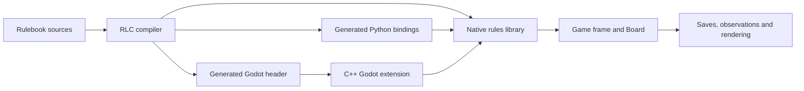
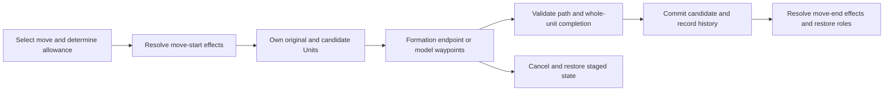
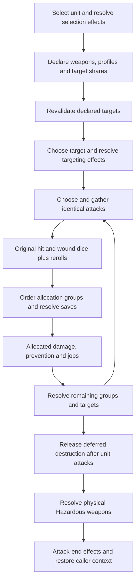
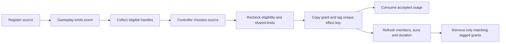

# Rulebook design and architecture

This guide explains how the `.rl` part of 4Hammer is organized, how a decision advances the simulation, and where a new mechanic belongs. It describes the implementation after tasks 17.D/E, using Rulebook compiler 0.4.17. [ROADMAP.md](../ROADMAP.md) owns migration status and validation evidence; this guide describes the design. The engine still contains legacy roster data and compatibility entrypoints while the 11th-edition migration proceeds.

Use the [procedural rules reference](11th-edition-core-rules-procedural.txt) and [supplied appendix](11th-edition-supplied-appendix.md) for game rules. The architecture supports those rules, but its storage bounds, schemas and UI protocols are project decisions. [AGENTS.md](../AGENTS.md) records development constraints and the language conventions used here.

## Contents

- [System boundary](#system-boundary)
- [Module map](#module-map)
- [Execution and action frames](#execution-and-action-frames)
- [State, identity and ownership](#state-identity-and-ownership)
- [Bounded storage and observations](#bounded-storage-and-observations)
- [Turn sequence and decision ownership](#turn-sequence-and-decision-ownership)
- [Movement and placement](#movement-and-placement)
- [Combat resolution](#combat-resolution)
- [Effective characteristics and predicates](#effective-characteristics-and-predicates)
- [Source events and lasting effects](#source-events-and-lasting-effects)
- [Transports, geometry and missions](#transports-geometry-and-missions)
- [Godot integration](#godot-integration)
- [Saves, traces and compatibility](#saves-traces-and-compatibility)
- [Validation architecture](#validation-architecture)
- [Extending the engine](#extending-the-engine)
- [Tradeoffs and remaining work](#tradeoffs-and-remaining-work)

## System boundary

Rulebook defines game state, legal inputs and state transitions. The compiler turns that description into native code and generates bindings. Godot presents choices and renders state; Python exposes simulations and learning environments. Both clients call the same compiled rules.



The public full-game entrypoint is [full_game.rl](../src/full_game.rl). Its `@classes act play() -> Game` owns a `Board`, delegates army selection for both players, then delegates the battle. It also supplies scoring and the current-player query. [game_utils.rl](../src/game_utils.rl) supplies the shared chance/terminal classification, fuzzer and binding-instantiation helper `gen_methods()`.

A scenario can provide its own `play() -> Game` and score function while reusing the same mechanics. [single_shooting_maximize.rl](../examples/single_shooting_maximize.rl) constructs a small board and delegates one attack; [single_turn.rl](../examples/single_turn.rl) constructs rosters and delegates a round. Each root generates its own action catalog and frame layout. A trace or fuzzer input for one root must be replayed against that root.

The host-facing environment contract includes:

| API | Role |
| --- | --- |
| `play()` | Construct the root frame and advance to its first decision |
| `get_current_player(Game)` | Identify the player, chance node or terminal state |
| `score(Game, Int)` | Root-specific evaluation/reward; a focused scenario can use a different objective |
| `get_num_players()` | Declare the two-player environment |
| `max_game_lenght()` | Existing, deliberately preserved spelling of the action-budget helper |
| `enumerate`, `can apply`, `apply` | Build candidate payloads, test legality and advance the simulation |

The action budget is a host/harness limit; it is separate from the battle's five-round sequence.

The module map below describes responsibility boundaries. Imports expose shared declarations, and some types depend on generated frames declared elsewhere in the compiled program, such as `Board.attack: Attack`. This is a jointly compiled rules system; the responsibility map should not be read as a strict, acyclic package dependency graph. Compile a scenario/test root with `-i src` to make its modules available, and generate host bindings from that same root.

## Module map

| Responsibility | Modules | Principal contents |
| --- | --- | --- |
| Public environment | [full_game.rl](../src/full_game.rl), [game_utils.rl](../src/game_utils.rl) | `Game`, `play`, scoring, player classification, action instantiation and `fuzz` |
| Interactive orchestration | [rules.rl](../src/rules.rl) | Battle/round/turn/phase frames, dice decisions, declarations, attacks, movement, damage resolution and timing choices |
| Shared storage contracts | [state_types.rl](../src/state_types.rl) | Bounds, schemas, `CheckedVector`, histories, timing, allocation and setup metadata |
| Board and entities | [board.rl](../src/board.rl), [units.rl](../src/units.rl) | `Board`, `Unit`, `Model`, positional selectors, identity allocation, banks, query contexts and roster factories |
| Profile and army data | [stats.rl](../src/stats.rl), [army_configuration.rl](../src/army_configuration.rl) | Profiles/keywords/abilities, legacy roster identifiers, army identity, detachments, reserve mode and CP metadata |
| Weapons and names | [weapons.rl](../src/weapons.rl), [named_identities.rl](../src/named_identities.rl) | Weapon profiles/rules, `Stat`, compound expressions and stable datasheet/family/profile catalogs |
| Arithmetic and conditions | [modifiers.rl](../src/modifiers.rl), [keyword_predicates.rl](../src/keyword_predicates.rl) | Ordered modifier operations, characteristic limits, incoming AP/D records and ALL/ANY/NONE predicates |
| Attack declaration and dice | [attack_declarations.rl](../src/attack_declarations.rl), [attack_dice.rl](../src/attack_dice.rl) | `DeclaredWeapon`, target/share metadata, attack-group identity, original dice batches and result classification |
| Shooting and weapon abilities | [shooting_rules.rl](../src/shooting_rules.rl), [weapon_abilities.rl](../src/weapon_abilities.rl) | Shooting-mode legality, selected per-slot abilities, duplicate-instance choices and target conditions |
| Damage and destruction | [damage_rules.rl](../src/damage_rules.rl) | Allocation groups, save/recipient predicates, `DamageJob`, pending destruction and wound commitment helpers |
| Spatial primitives | [vector2d.rl](../src/vector2d.rl), [geometry.rl](../src/geometry.rl) | Grid positions, calculation vectors, bases, terrain bounds, distances, overlap and coherency |
| Movement and setup | [movement_geometry.rl](../src/movement_geometry.rl), [movement_rules.rl](../src/movement_rules.rl) | Paths, candidate placement, traversal, deployment/reserve searches, move eligibility and history |
| Charges and fighting | [charge_rules.rl](../src/charge_rules.rl), [fight_rules.rl](../src/fight_rules.rl) | Charge target/path/completion predicates, Pile In/consolidation constraints and fight eligibility |
| Terrain and objectives | [terrain_rules.rl](../src/terrain_rules.rl) | Visibility abstraction, area membership, cover, target conditions and objective/action eligibility |
| Core stratagems and actions | [core_stratagem_rules.rl](../src/core_stratagem_rules.rl) | Core effect eligibility and phase-local action permissions; shared CP payment is on `Board` |
| Transport and borrowed weapons | [transport_rules.rl](../src/transport_rules.rl), [firing_deck_rules.rl](../src/firing_deck_rules.rl) | Carrier/passenger links, embark/disembark setup, capacity, emergency setup and Firing Deck selections |
| Source lifecycle | [source_effect_types.rl](../src/source_effect_types.rl), [source_effects.rl](../src/source_effects.rl) | Source/event/use/effect records, eligibility, typed grants, expiry, aura refresh and restore validation |

Most interactive sequences live in `rules.rl`. The smaller modules expose calculations, predicates and explicit mutation helpers. Some domain modules also own a small interactive frame, such as `choose_weapon_abilities` or `select_firing_deck`. Keep reusable mechanics in those modules and let the orchestration frame decide when to invoke them.

## Execution and action frames

### A suspended frame is part of game state

An action function constructs a resumable frame. Ordinary statements run until an input boundary; supplying that input resumes execution until another boundary or completion. The generated frame retains its continuation and persistent variables. Saving only model positions and wounds would therefore lose the current decision, declared attacks, chosen targets and pending dice.

The full-game composition, abbreviated from `full_game.rl`, is:

```text
@classes
act play() -> Game:
    frm board : Board
    board.mission_scoring = MissionScoringMode::legacy_four_markers
    subaction*(board) p1 = pick_army(board, false)
    subaction*(board) p2 = pick_army(board, true)
    subaction*(board) battle = battle(board)
```

The nested frames form the active call chain. For example, `Game` may be suspended inside a battle, turn, Shooting phase, attack, allocation and dice sequence. `subaction*` forwards the child's inputs through the parent until the child finishes. The star form is widely used here; a single-step `subaction` has different delegation semantics.

| Declaration | Lifetime and purpose |
| --- | --- |
| `let` | Local computation within the current uninterrupted execution; use for transient integers/floats and calculations |
| `frm` | Value retained in the action frame across input boundaries; also used for exposed results and snapshots |
| `ctx` | Caller-owned object supplied to the action frame; subsequent child calls need that context |
| `ref` | Explicit alias to an existing object or collection entry; mutation affects that object |

`act attack(ctx Board board, frm UnitID source, ...) -> Attack` shares the caller's board while retaining its selected source. `subaction*(board, declarations)` forwards the contexts required by a child. This makes shared mutation explicit while keeping interactive progress in the frame. Context argument order and types are part of the callable interface.

Function parameters are passed by reference, so an ordinary `fun` can mutate its caller's state. A `ref` return exposes the existing object. Inferred locals initialized from reference-returning expressions require care: for an owning rollback snapshot, declare `frm original : Unit` first and then assign `original = board[source]`. Do not rely on an inferred alias to preserve the pre-move value.

### Legality and the action catalog

An input declaration's braces express preconditions. The generated `can` check combines those predicates with the current resume point. A payload can be in the global catalog while being unavailable in the current state.

`@classes` generates payload classes and the tagged union `AnyGameAction`. A payload contains an action's arguments; the `Game` frame contains the simulation. Hosts enumerate payload candidates, filter with `can apply(action, state)`, then execute with `apply(action, state)`. Direct frame calls, such as a test supplying a child dice result, use the same generated transition machinery.

Enumeration combines finite argument domains. Two independent arguments multiply their candidate counts, and the global union includes all exposed action types. Preconditions must safely reject unused indices before indexing a collection: the host evaluates them for candidates beyond the current live count.

A newly available action must either advance the sequence, change relevant state, or provide an intentional exit. A nonterminal state with no legal actions is a stall. The fuzzer explicitly checks that invariant.

### Randomness is input

Dice results enter through explicit actions such as `roll`, `roll_pair`, `reroll`, `reroll_pair` and `quantity`. The core transition is deterministic once the payload is supplied. This supports controlled tests, chance-node learning and replay without a hidden random generator inside the rules.

`Stat` is `FixedStat | Dice | CompoundDice`. Compound expressions retain their original one-to-three D3/D6 dice and intrinsic constant. `evaluate_random_stat` requests each original die; `evaluate_weapon_characteristic` handles whole-roll re-rolls and subsequent arithmetic. A D3 shares the six-face payload type but permits only results 1–3. Random A is determined separately for each selected weapon at gathering; random D is determined for each damaging attack after allocation; random M is selected for the unit's move.

## State, identity and ownership

`Game` owns the board and the nested execution frames. `Board` owns the battlefield, offboard banks, armies, objectives, histories, source records and shared interactive contexts. It also retains reusable frames such as `attack`, `current_roll` and `current_pair_roll`. The complete observation/save layout consequently includes more than the entity roster.

`Unit` owns live models, unit history and archived casualties. `Model` owns profile/keyword/wargear metadata, wound and destruction state, geometry, movement history and sparse modifiers. `AttackSequenceInfo` holds the current attack context and gathered characteristic/rule snapshots. Fields such as `moving_unit`, `active_allocation_target`, `pending_weapon_abilities` and `active_source_events` expose the suspended decision to clients.

### Slots identify current choices; identities identify entities

| Identifier | Meaning | Appropriate use |
| --- | --- | --- |
| `UnitID` | Slot in the collection used by that action | Current battlefield/reserve/passenger selection, with the bank determined by the caller |
| `ModelID` | Current model index within the selected unit | Immediate model choice, resolved using the active unit context |
| `EntityIdentity` | Stable unit/model handle; zero is unset | Sources, recipients, archives, origin/component links and references surviving compaction/transfer |
| Weapon slot | Profile entry in a model's equipped list | Selecting a current profile and applying slot-specific grants |
| Nonzero physical group | Several profiles of one equipped copy | Profile exclusivity and shared physical-weapon usage; group zero leaves the slot independent |
| Named family/profile code | Catalog identity | A grant targeting all copies of a named family or one named profile |
| `SourceEffectKey` | Monotonic handle of an installed effect | Removing one source's grants without removing overlapping equal grants |

`Board.identify_unit` allocates entity handles; `find_unit`, `Unit.find_model` and `locate_source` resolve them. Casualty removal compacts the live model vector and archives the original model with its identity and weapon history. Battlefield unit slots are retired instead of being freely compacted; reserve/passenger collections can compact, and transfers retain identities and explicit return-slot information.

A model index saved before a casualty can refer to a different model afterward. A stable handle must be resolved again at use. The same principle applies to a Leader/source moving between units: the current containing unit is looked up from the model identity rather than permanently inferred from its original slot.

### Lifecycle

Prefer generated initialization and destruction on game classes. A custom `init` replaces automatic initialization of **all** fields; a custom `drop` replaces automatic destruction of **all** fields. Such methods must manually handle every field, including owning containers and nested classes. These hooks primarily serve primitive containers, and a partial game-class initializer/destructor is unsafe.

Copying a board, unit or frame can copy substantial owning storage. Use aliases for queries and explicit owning copies for staging/simulation branches. Collection mutation may invalidate a borrowed element wrapper; resolve or refresh it after append/erase. Sanitizer checks complement semantic assertions when owning snapshots or frame lifetimes change.

## Bounded storage and observations

The project requires authored persistent numeric game/frame values to use `BInt`, `LinearlyDistributedInt`, Bool or enums. Local `Int`/`Float` calculations are allowed. Standard-library container internals and compiler-generated continuation metadata have their own primitive representation.

`BInt<min,max>` has a finite half-open domain and a categorical observation encoding. `LinearlyDistributedInt<min,max>` has a finite domain with a compact linear observation encoding. Both can participate in enumeration; linear observation encoding does not make an action's candidates disappear. Their assignment/arithmetic can clamp, so validate important totals before assigning them to bounded storage. Direct `.value` writes can bypass the wrapper's checks and need explicit validation.

`CheckedVector<T,capacity>` wraps the standard bounded vector and asserts on overflow instead of silently discarding an append. Its observation adapters delegate to that standard representation. Capacities define supported implementation envelopes; increasing one can enlarge every owning frame's inferred layout. Raw profile/weapon/keyword enums also have existing observation adapters in their defining modules. Inspect those adapters when changing catalogs.

`Hidden<T>` excludes a field from the ML observation, but the standard library preserves its value in text/binary serialization. Names and casualty archives use it. This wrapper is unrelated to gameplay's visibility/Hidden rules, and it must not be used to conceal an unbounded numeric game value from layout inference.

### Spatial domains

| Representation | Current domain | Purpose |
| --- | --- | --- |
| `BoardPosition` storage | x 0–43, y 0–29 | Whole-inch model anchors and the existing Godot payload/getters |
| Enumerated `BoardPosition` inputs | x 1–43, y 1–29 | 1,247 candidates; positive-size bases cannot fit centered on zero edges |
| `StoredGridPoint` | Whole-inch x/y plus z 0–30 | Persisted movement paths |
| `StoredTerrainPoint` | x 0–44, y 0–30, z 0–30 | Terrain corners, including outer edges |
| `GeometryPoint` and float calculations | Reconstructed physical precision | Temporary base distances, intersections and path measurements |

There is no z-coordinate action. Model elevation and terrain/path metadata retain their bounded domains. Physical calculations can reconstruct micrometre coordinates and use local floats while actual saved positions remain quads. `ModelHistory` stores bounded squared horizontal segment lengths plus vertical distance, then computes square roots on demand; it does not persist a float distance cache.

The current full-game layout is state/observation schema **25**, action schema **15**, with next-state bound **26**. The validated catalog has **22,678** candidates and **25,682,905** observation values. These are a versioned snapshot, not stable promises. `state_types.rl` and ROADMAP.md are authoritative after further changes. Finite layout is necessary for learning; its size and the cost of fetching wrappers still need attention.

## Turn sequence and decision ownership

`battle` assigns identities, invokes the current attachment step, captures starting strengths, resolves transport formations/reserves/deployment/Scouts, then runs five rounds. Each round resolves start effects, both players' turns, end effects and reserve expiry. The public game explicitly selects a legacy four-marker mission fixture.

A turn runs Command, Movement, Shooting, Charge and Fight. `resolve_timing_window` brackets the turn and each phase. Phase boundaries handle objective snapshots, mission scoring where configured, effect expiry and retained-model cleanup. Unit/model histories use phase/turn stamps to express restrictions; those records are separate from a frame's current continuation.

Most unit history markers store serial+1 so zero means unset. Source effect/use records capture their current serial directly. Follow the owning helper's convention when comparing or resetting a field; matching bounded types do not imply matching sentinel semantics.

| Role/query | Meaning |
| --- | --- |
| `Board.current_player` | Player whose turn it is |
| `Board.timing.active_player` | Active role for the current sequence, which can temporarily change during a nested action |
| `Board.current_decision_maker` | Player choosing the next non-random input |
| `TimingState.controller` | Controller currently resolving its timing-window group |
| Public player query `-1` | Chance input is available |
| Public player query `-4` | Game is complete |
| Public player query `0` or `1` | Player owning the current ordinary decision |

`default_get_current_player` first checks completion, then the supported dice-action shapes, then reads `current_decision_maker`. Adding a new chance-input name requires auditing that classifier; an unrecognized random action could be assigned to a player.

Timing/source sequences implement the supplied current-player-first ordering, with each controller choosing its effects before the opponent's group. Nested attack, movement, source and damage frames save the roles/selector contexts they replace and restore them when finished. Opponent allocation, reaction movement and chance therefore do not change the owner of the overall turn.

The existing timing dispatcher still has nine legacy `TimingRule` kinds. Registered source instances share the controller groups through `choose_window_source`; general move/attack/shock/destruction events use `resolve_source_event`. These paths coexist while source-specific abilities migrate.

## Movement and placement

Movement is split between interactive choices in `rules.rl`, path geometry in `movement_geometry.rl`, and setup/history policy in `movement_rules.rl`. Charges and melee moves add their own completion constraints through `charge_rules.rl` and `fight_rules.rl`.



The common `move` kernel snapshots the unit **after** move-start effects. It supports a complete formation translation or explicit model paths. Path checks handle length, overlap, traversal and placement; finishing the unit also checks required movement/coherency. `move_to` completes a legal formation move directly, while model waypoints accumulate in a candidate until completion.

Charge and melee frames reuse the spatial helpers with different closest-target, engagement and completion obligations. Some workflows temporarily publish a candidate to the board for preview and restore the original on cancellation. Cancellation does not imply refunding already committed CP or forgetting a declared charge; each caller owns those rules.

Setup uses shared placement checks for deployment, Scouts and ingress, supplemented by the relevant zone/range/round policy. Searches test supported formations or model placements before committing a bank transfer. They must distinguish unavailable supported placement from an unchecked geometry shortcut. The user-directed policy destroys reserve units that cannot be placed by the supported deployment search.

For a spatial extension, update the common predicates and the relevant caller policy. Adding a weaker one-off range check in a UI handler would let the native/ML clients disagree with the editor.

## Combat resolution

The main current attack path is `attack` in `rules.rl`. Selected shooting, fighting and suitable nested effects configure it and generally store/delegate `Board.attack`. Earlier per-model/per-weapon functions remain in the module, so follow the caller before choosing a place to modify combat.



### Declarations preserve commitments

`DeclaredWeapon` snapshots a selected profile, bearer/physical identity, named selectors, chosen weapon rules and target/share information. Fixed melee shares are allocated before resolution. Random ranged attack counts are gathered separately per weapon. The project explicitly asserts that random-A melee weapons are unsupported, as directed by the user.

Slot, physical copy, named weapon family and named profile are different scopes. Nonzero physical group IDs link alternate profiles of one equipped weapon. Ordinary selection picks one profile; explicit sourced metadata allows Nazdreg's multiple ranged profiles. One Shot history is shared by profiles of that copy, and Hazardous counts a selected physical weapon once. Equal printed names alone do not identify the same copy.

Target revalidation is a separate frame. If an earlier declaration becomes ineligible, it offers the defined replacement/decline path instead of resolving against stale positions or silently treating a new unit as the old target. The attacking controller chooses target/group order, and a target is resolved completely before switching to another.

### Gathered context and live queries

`gather_attack_group` combines declarations only when their relevant effective characteristics/rules agree. `AttackSequenceInfo` carries current source/target IDs, effective S/T context, selected abilities and skill/AP/D operations. The next group refreshes target Toughness and bearer status, including Damaged, so intervening casualties or changes do not leave a stale attack context.

Group identity includes random damage shape and its complete modified mapping. Two distributions do not become identical merely because one replacement makes their final damage equal. Incoming recipient AP/D effects also participate in the comparison where required. This is separate from the printed allocation groups, which combine the appropriate W/Sv/InSv recipients and treat Characters individually.

Original dice batches retain unmodified values and re-roll history. Critical classification reads those values; modifiers apply afterward with the relevant caps. `weapon_abilities.rl` preserves a selected duplicate ability instance and its condition rather than summing every duplicate indiscriminately.

### Damage and destruction are a lifecycle

`resolve_attack_damage` owns saves, allocation and per-allocated-attack D. `prevent_wound_loss` owns prevention/FNP. `resolve_damage_jobs` processes a bounded work stack for normal, mortal, Devastating, removal, emergency transport and deferred demise work. The stack avoids unbounded recursive action frames while maintaining explicit ordering.

A wound commitment can retain a destroyed model for its triggered effects or Fight on Death. It remains physically present but is excluded from ordinary live-recipient checks. Attack-caused destruction triggers are released at the prescribed completion point; passenger emergency work precedes carrier demise, and removal/archive work happens after the retained effects. Ordinary mortality and Devastating damage have different spill policies even though both reach the job resolver.

Damage frames temporarily set `attack_info.target_unit_id` to the actual casualty unit. This is essential for Godot ModelID choices: self-inflicted Hazardous or a destruction cascade may target models outside the original attack target. The previous context is restored afterward.

## Effective characteristics and predicates

Profile/weapon enum methods provide base data. Mutable arithmetic lives in sparse records attached to the affected bearer or recipient. The effective queries combine those records at the actual consumer instead of permanently rewriting the base profile.

`CharacteristicModifier` has a characteristic, operation, optional slot/physical/name filters and source-effect ownership. `IncomingAttackModifier` belongs to the allocated recipient and has any/ranged/melee scope for AP or D. Characteristic changes and dice-roll modifiers have separate policies; changing BS is different from adding to a hit roll.

`modifiers.rl` applies replacement, multiplication, addition, division and subtraction, then rounds up once and applies characteristic limits. Intrinsic constants in dice expressions enter the original characteristic. Core increments such as cover-related arithmetic must enter the correct operation step. Replacement-zero and absent/special characteristics have explicit locking behavior. Bounded assignment is storage protection, not the tabletop arithmetic policy.

`KeywordPredicate` stores the conjunction of ALL, ANY and NONE groups. A unit query uses the constituent keyword union; a model query uses the individual model. Live/offboard eligibility is checked separately from keyword membership. Named unit/weapon predicates use the stable catalogs in `named_identities.rl`, rather than a legacy factory/display name.

Source-installed numerical records use the same effective M/T/Sv/InSv/Ld/OC and Range/skill/S/AP/A/D consumers as manual fixtures. Incoming reductions reach actual saves and damage. Selective modifier ignoring remains task 17.C4b; do not describe a negative-only automatic filter as the planned optional subset choice.

## Source events and lasting effects

The source framework makes an ability's origin, usage and duration explicit. It currently installs typed characteristic, incoming-attack and weapon-rule grants. Actual faction abilities and specialized reactions need their source adapters; registration alone does not make every audited ability executable.

| Record | Role |
| --- | --- |
| `SourceInstance` | Registered source: stable unit/model, owner, explicit rule code, trigger/conditions, scope, limits, grant and duration |
| `SourceEvent` | Snapshot of the gameplay boundary and involved stable entities |
| `PendingSourceEvent` | Source handle plus event, retained while the controller resolves choices |
| `SourceUseRecord` | Rule/player/scope/subject usage across phase, turn, round and battle intervals |
| `SourceEffect` | One accepted installation with a unique key, target/recipient identities and expiration metadata |



`collect_source_events` freezes candidate handles, and `pending_source_valid` rechecks each at resolution. An earlier effect can consume a shared army limit or remove another source. Optional passes spend no usage; mandatory eligible sources prevent finishing the controller's group. `active_source_events` exposes labels to the UI and is saved/restored around nested event resolution.

Usage keys combine the **explicit rule code**, player, army/unit/model scope and stable subject. Display names do not imply shared limits. Phase/turn/round/battle limits are conjunctive, and interval resets retain battle totals. Unit scope follows the current containing unit of a model source where relevant.

`commit_pending_source` copies the payload before tagging it. Each installed copy has its own `SourceEffectKey`; equal overlapping buffs therefore expire independently. Zero denotes an intrinsic/manual grant. Removing one key scans every live/offboard bank and casualty archive. Unit-wide grants refresh returned members without duplicating surviving records; stale weapon-rule snapshots check that their key is still active.

Passive unit auras refresh source life/disablement, recipient keywords and base range. Exit removes their owned grants; entry can install a new key. Own units remain in range of their own abilities, and offboard permission never authorizes external distance/visibility measurements. Model-specific and wholly-within aura modes remain source-adapter work.

Configured source/pending/effect/use capacities are 64, rule codes are 1–512 and monotonic effect keys are 1–4096. Registered source slots are disabled rather than erased/reindexed. Overflow asserts. These capacities must be reviewed against actual playable army combinations as data/adapters arrive.

## Transports, geometry and missions

Transports hold whole passenger units in `Board.embarked_units`. `Unit.embarked_transport` identifies the **carrier model**, not its current unit slot. This survives model/collection movement and allows one unit to contain multiple potential carriers. `transport_rules.rl` supplies seat/permission checks, setup search, staging/commit and link validation; interactive disembarkation is coordinated in `rules.rl`.

Firing Deck creates borrowed declarations in the same attack pipeline. They preserve the passenger's physical weapon owner/name/profile while applying carrier-wide numerical grants and the appropriate carrier status. Carrier equipped-slot grants must not accidentally affect a passenger weapon merely because its slot number matches. Passenger shooting locks and borrowed One Shot history survive the bank transition.

The spatial model preserves whole-inch anchors with circle/base calculations and bounded elevation. Unsupported oval/hull/multipart footprints have an explicit gate. Visibility uses the user-approved abstraction: units are generally at least visible, and intervening terrain areas provide partial obscuring. Existing solid-box movement primitives remain separate from the area visibility model. Exact model-body visibility and a continuous-position migration are outside the current scope.

Objectives use configured marker/area metadata and stored control snapshots at rule boundaries. A bare `Board` has no mission scoring; public `play()` explicitly selects the legacy mission fixture. New mission scoring needs its own supplied definitions and boundary consumers.

Army identity and up-to-three Orks detachment selections live in `ArmyConfiguration`, separately from legacy `Faction` roster IDs. Public selection explicitly enables point-free reserve budgeting under user authority. Existing point-aware fixture metadata remains supported. Detachment/CP registries provide configuration and cost/gate information; full card/enhancement effects remain later batches.

## Godot integration

The compiler emits `rules.inc`; [gdexample.cpp](../src/gdexample.cpp) includes it and registers the generated classes/methods in the Godot extension. `GlobalRules` in [Rules.gd](../scripts/Rules.gd) owns the native `Game`, enumerates `RLCAnyGameAction`, filters legality and emits action/state signals. The UI inspects generated payloads through `unwrap()`, `members_count()` and `get_member()`.

| Payload shape | Default interaction and constraints |
| --- | --- |
| No members | Choice button |
| One enum or Bool | Labeled choice buttons |
| One `UnitID` | Unit click; explicit buttons handle reserve/passenger banks |
| Two `UnitID` members | Source then target click; order is part of the UI contract |
| One `ModelID` | Click within the active target/moving-unit context; offboard model selectors use buttons |
| One `BoardPosition` | Grid-location input through the existing x/y getters |
| Other bounded numeric selector | Explicit control/button support is needed; examples include allocation, attack-group and source-event choices |

[InteractionManager.gd](../scripts/InteractionManager.gd) handles battlefield model/unit clicks and highlights. [SelectPointManager.gd](../scripts/SelectPointManager.gd) converts screen coordinates to the 64-pixel grid. [MultipleChoises.gd](../scripts/MultipleChoises.gd) handles generic choices and special named buttons, including source instances, reserve deployment and Firing Deck. [boardl.gd](../scripts/boardl.gd) renders board state.

Autodetection depends on argument **types, counts, order and generated names**, not just rule legality. `UnitID` does not itself encode which bank it selects; the specialized caller/control provides that meaning. Shape-based selectors often choose the first matching legal action type, so simultaneous same-shape choices can require explicit controls. A renamed action, reordered source/target, changed public frame or added argument requires auditing these consumers.

For example, a source button supplies a `GameChooseWindowSource` payload inside `AnyGameAction`. `GlobalRules` checks it against `Game`, the generated forwarding path reaches the suspended timing frame, and `commit_pending_source` mutates the shared board. Execution then advertises the next decision or completes the child. State-change signals refresh the legal list and views. The button, suspended child frame and installed effect are three distinct objects in that path.

`pretty_string` and `gen_methods()` make meaningful action labels and their generated instantiations available to bindings. Fixed-array metadata sometimes needs a typed accessor, as the physical-profile tests demonstrate. Rebuild matching native code, generated header and C++ wrapper together after layout/compiler changes. A candidate in the all-actions fallback is weaker evidence than a tested specialized interaction.

## Saves, traces and compatibility

There are three related compatibility surfaces:

1. **State:** the board, nested continuations, histories, identities and pending decisions.
2. **Actions:** generated payload types/fields and the ordered candidate catalog.
3. **Observations:** the inferred tensor shape and field encodings used by a learner.

`StateSchema` is a singleton bounded field initialized to the current state version. `NEXT_STATE_SCHEMA_VERSION` must be exactly one greater to keep its half-open domain a single value. Action and observation versions are separately exposed; they are compatibility metadata, not edition identifiers.

The Rulebook `set_state(Game,String)` parses into a candidate, runs `valid_state_foundations` and commits only on success. Domain checks cover identities, banks, numeric metadata, histories, weapon conditions and source references. Generic parsing success alone is insufficient, and board validation is not a proof of every possible game-history invariant. No automatic cross-schema migration is supplied.

Textual/binary action payload traces store selected inputs. The gameplay/fuzzer rank files instead store signed 8-byte integers that select a **rank in the currently legal list**, with the harness's trailing-byte convention. They depend on the root, candidate order and legality at every step. Full snapshots, payload traces and legal-rank fuzz inputs are different artifacts and should be labeled accordingly.

The full-game fuzzer reads choices while `index + 8 < input.size()`, maps each to the legal list and advances the frame. Inputs of at most eight bytes execute no decision. [TraceManager.gd](../scripts/TraceManager.gd) uses parsed action payloads for editor playback. Preserve old failing inputs where they still exercise the intended path; generate new complete-game inputs when schemas/catalogs change.

## Validation architecture

| Check | What it establishes | Entry points |
| --- | --- | --- |
| Deterministic rule assertions | Intended boundaries, ownership, legal/illegal inputs and actual state effects | [baseline.rl](../tests/baseline.rl), [known discrepancies](../tests/known_discrepancies.rl) and manifest |
| CTest fixtures | Test discovery, matching wrapper/native compilation and isolated assertion execution | [RuleTests.cmake](../cmake/RuleTests.cmake), [ctest_rules.py](../tools/ctest_rules.py) |
| Native sanitizer cases | Ownership, cleanup, bounds and undefined-behavior checks on focused paths | Prepared native drivers documented in [tests/README.md](../tests/README.md) |
| Seeded game and Gym | Completion, legal-action/text round trips, owner protocol and finite observation layout | [check_gameplay_baseline.py](../tools/check_gameplay_baseline.py), [check_gym_baseline.py](../tools/check_gym_baseline.py) |
| Godot interaction checks | Matching bindings, selectors, labels and the exercised controls | [check_godot_state.py](../tools/check_godot_state.py), `tests/godot_*.gd` |
| Fuzzer replay/mutation | Preserved failures and robustness across legal action sequences | `game_utils.rl:fuzz`, CMake target `rlc_rules_fuzzer`, [fuzz regressions](../tests/fuzz-regressions/README.md) |

CMake discovers zero-argument `test_*() -> Bool` functions. Each suite's fixture generates a Python wrapper and matching native library once per CTest invocation, validates its declarations, then runs each test in a separate process. The baseline rejects zero tests. Known false discrepancy assertions are XFAIL/Skipped; an unexpected pass requires promotion, and crashes/failures fail the run. The current discrepancy manifest is empty.

For debug checks in the prepared cloud environment:

```bash
source /workspace/4hammer-venv/bin/activate
cmake -S . -B /workspace/4hammer-validation/current-tests \
  -DBUILD_GAME=OFF -DRULE_TEST_COMPILER_JOBS=4
ctest --test-dir /workspace/4hammer-validation/current-tests \
  --output-on-failure -j 4
```

The compiler worker count and CTest process count are independent. Debug compilation remains unoptimized; enable `RULE_TEST_OPTIMIZE` or `-O2` only for separate optimized validation. Direct builds use matching `rl_language`/`rl_language_core` 0.4.17 and `-j 4`. Sanitized fuzzer builds additionally require the matching Clang/LLVM runtime documented in tests/README.md.

Freeze test declarations before compiling/registering the final suite. Reconfigure CMake after discovery changes. Use explicit fixture metadata to prove a consumer works; a game using legacy armies may never exercise a new source ability. A sanitizer pass proves different properties from a semantic assertion, and a short mutation campaign cannot certify the entire rules edition. Documentation-only changes need link/source checks rather than repeating expensive engine builds.

## Extending the engine

Start with the printed source and the owning ROADMAP task. Identify whether the change is data, an effective query, eligibility, an interactive decision or a lifecycle transition. Follow its real caller through suspension points before adding a new frame or flag.

| New requirement | Preferred location/approach |
| --- | --- |
| A profile, equipment option or named identity | Explicit data/factory and catalog metadata; distinguish physical copies and alternate profiles |
| A numerical buff/reduction | Existing characteristic/incoming records and effective consumers; retain scope/provenance |
| A keyword condition | ALL/ANY/NONE predicates with explicit unit/model subject |
| A timed grant or passive unit aura | Register a source with exact rule code, conditions, limits and typed grant; use owned expiry |
| A rule requiring a player decision | Action frame/preconditions, role restoration and an audited Godot payload/control |
| A special movement permission | Common spatial kernel plus caller-specific eligibility/completion policy |
| Damage, casualty or destruction work | Allocation/prevention/job/lifecycle pipeline with stable recipients and release timing |
| A specialized reaction/healing/psychic effect | A deliberate source adapter and required core handler; extend typed infrastructure only where the existing grant cannot express it |

When adding a persisted field, choose its bound/sentinel and check its observation contribution. When adding a long-lived reference, choose stable identity instead of a compacting index. When adding a snapshot, state what is declared/frozen and what must be refreshed. When adding a use limit, state the rule/player/scope/subject and reset boundary. Each materially changed function/action should explain its purpose and cite the rule source.

Test the actual consumer and legal/illegal inputs, then test relevant banks, overlapping grants, cancellation, role restoration and save/restore. Lifecycle changes need sanitizer coverage; action changes need generated-binding/control checks. Record completed work and unresolved source/geometry dependencies in ROADMAP.md. Keep independent changes and their regressions in focused, buildable commits.

## Tradeoffs and remaining work

The resumable-frame model gives the rules, UI, replay and learning clients a shared description of decisions. Its cost is that every retained field/child frame contributes to copying, generated bindings and often observations. Sparse modifier records and linear identities reduce layout growth, but a bounded layout can still be large.

The generic action catalog makes host integration simple and exhaustive. Hosts currently scan it to find legal candidates, and generated wrapper fetching has a measured cost. Small coordinate domains reduce candidates; they do not remove wrapper overhead. Task 17.Q owns the required performance fix and broader rendered/integration validation.

`rules.rl` remains a large orchestration module, with older combat/attachment and faction-specific paths beside the new helpers. A new implementation should follow its callers and the roadmap rather than infer completion from a type, enum entry or factory name. The current attachment entrypoint is legacy; complete source-backed Leader/Support lifecycle remains 17.G.

Current gaps include 17.C4b's optional modifier subsets, full current Orks profile/loadout/ability migration, specialized source reactions, healing/revival/psychic consumers, and oval/hull/multipart geometry. Points/DP accounting, continuous positions and exact body visibility are excluded by user direction. See [the Orks audit](orks-codebase-audit.md), [coverage map](11th-edition-rule-coverage.md) and [ROADMAP.md](../ROADMAP.md) for precise ownership and source dependencies.

For subsystem detail, use [attack declarations/dice](attack-declarations-dice.md), [damage/destruction](saves-damage-destruction.md), [movement/deployment](movement-deployment.md), [modifiers](model-characteristics.md), [physical weapons/compound dice](physical-weapons-compound-dice.md), [source effects](source-instances-effects.md) and [transports/Aircraft](transports-aircraft.md). Earlier reports contain historical schemas/test counts; current source and the latest roadmap completion section take precedence.

For language syntax beyond this project's conventions, consult the official [language tour](https://rl-language.github.io/language_tour.html), [language reference](https://rl-language.github.io/language-reference.html) and [action library](https://rl-language.github.io/stdlib/action.html). Confirm version-sensitive behavior against the pinned compiler and its installed standard library.
